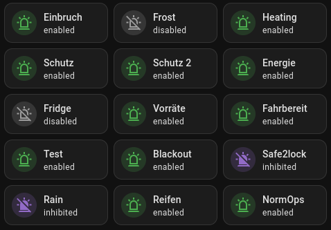

# miqro_alarm

This is a full-fledged alarm logic, completely based on MQTT inputs and outputs. Reliability was a top priority during development.

Features:

 * Listens to MQTT topics for alarm inputs
 * Custom conditions for alarms can be expressed, e.g., if a value rises above a certain threshold
 * Prealarms are supported - raise awareness to an issue before the full alarm is triggered, or allow time for disabling the alarm
 * Debouncing of input signals is supported, e.g., to avoid false alarms due to sensor noise
 * Alarm outputs:
    * Text messages sent to MQTT topics (e.g., an SMS gateway, push message provider, etc.) 
    * Switch outputs, i.e., MQTT topics expecting custom messages (e.g., to connect to other MQTT services or to drive lights, sirens, etc.)
        * Messages can be repeated in custom intervals
        * Different alarm schedules can be mapped to one topic, e.g., to show a different light pattern for intrusion alarms and fire alarms
 * Alarm groups capture multiple inputs and drive one or more alarm outputs
 * Comprehensive support for liveness checks:
    * If an MQTT topic is not received in a certain interval, send a notification
    * Ensure that other services are alive, send notification if they fail
    * Can call an external HTTP liveness check to ensure the alarm service is still running
 * Support for alarm inhibition (e.g., suppress an intrusion alarm when owner is at home)
 * Alarms can be switched on/off and observed via MQTT

See (examples/miqro.example.yml)[examples/miqro.example.yml] for configuration examples.

## Installing


To install the software, follow these steps **as root**:

 * If `pip3` is not installed, run `apt install python3-pip` first.
 * Then run `pip3 install miqro_alarm` 
 * Create the configuration file `/etc/miqro.yml`
   * See [examples/miqro.example.yml](examples/miqro.example.yml) for an example
   * See [the MIQRO documentation](https://github.com/danielfett/miqro#configuration-file) for other options you can use in the configuration file
 * Install the system service: 
   * `miqro_alarm  --install`
   * `systemctl enable miqro_alarm`
   * `systemctl start miqro_alarm`


## Configuration

The configuration is based on a few concepts:

 * **Outputs** define MQTT topics an alarm can be sent to. This can be:
   * A **text output**: This output is defined by a single MQTT topic that accepts a human-readable message, for example, an SMS gateway.
   * A **switch output**: Defines one or more MQTT topics that accept custom messages. This can be used to drive lights, sirens, etc. You can define separate MQTT topics for different alarm schedules, e.g., to show a different light pattern for intrusion alarms and fire alarms. For each alarm schedule, you can define the MQTT topic, the message that is sent when the alarm is activated, whether the message is to be repeated, and an MQTT topic and message that is sent when the alarm is deactivated.
 * **Alarm Groups** define a set of inputs that are to be monitored. If any of the inputs is triggered, the alarm for the group is activated. Each alarm group offers a number of configuration options:
   * Each group has a **name** that it used in the MQTT messages and a human-readable **label**.
   * The alarm group can be configured to trigger a number of    
     **outputs** at once. 
   * You can also define a **prealarm**, which is activated before the alarm is triggered. After a defined interval, the prealarm is deactivated and the alarm is triggered. 
   * You can define a number of **inputs**. Each input is defined by a single MQTT topic and a condition. If the condition is met, the input is triggered. Conditions can be defined using python expressions. You can define a number of conditions, e.g., if a value rises above a certain threshold or if a value is below a certain threshold. Additionally, there is a timeout for each input that you can define. If no message is received for the input in the defined interval, the input is considered to be dead and a notification will be sent.
   * You can define **liveness checks** for each alarm group: If a liveness check is not triggered in a certain interval, a notification is sent. This can be used, e.g., to check that a sensor sends data in a certain interval or that another service is still running.
   * You can define **inhibitors** for each alarm group. If an inhibitor is triggered, the alarm is inhibited. This can be used, e.g., to suppress an intrusion alarm when the owner is at home.

See (examples/miqro.example.yml)[examples/miqro.example.yml] for configuration examples and explanations.

### Alarm messages

Text outputs receive one line per alarm group that is currently active, marked
with that group's own state:

```
⚠️ Prealarm, Ground floor: Front door
🚨 ALARM, Ground floor: Front door, Kitchen window
🚨 ALARM (update), Ground floor: Front door, Kitchen window
⎚ Cleared, Ground floor
```

A message is triggered by one group but restates all of them, so each line is
marked according to the group it names — a group that is only in prealarm is
never marked 🚨 because another group escalated. `(update)` means an additional
input triggered while the group was already active.

When a group's alarm ends it is reported as `⎚ Cleared`, including when other
groups are still active (`⎚ Cleared, Ground floor` followed by the remaining
`🚨 ALARM …` lines). Nothing is published when there is nothing to say.

### Notifications

Besides the alarm messages themselves, the service reports problems with itself
and its sensors to every text output configured with `info: True`. These
messages are about *conditions*, not events, and each condition produces exactly
two messages: one when it starts and one when it ends.

 * 🔴 **error** — something that is supposed to protect you does not: an input
   that has gone silent, or one whose payload its `when` expression cannot
   evaluate, a liveness check that keeps answering wrongly, an alarm output that
   cannot be driven.
 * 🟡 **warning** — the service still works, but not the way it is configured:
   an inhibitor that is being ignored because it cannot be trusted, an input
   holding an alarm open because it died while triggered. One-off events that
   need saying but cannot "end" — for example an alarm being restored after a
   restart — are also yellow.
 * 🟢 **resolved** — a previously reported condition is over.

Every message ends with the number of conditions that are active at that moment,
for example `[1 error, 0 warnings]`, so a single message is enough to tell
whether things are getting better or worse. Nothing is repeated while a
condition persists: a sensor emitting garbage ten times a second is reported
once. The current list is always available on `service/alarm/health/conditions`.

Notifications raised before the broker connection is up — stale sensor readings
found in the state file at startup, for instance — are held and sent once the
service connects, rather than being silently dropped.

### Reliability behaviour

Some deliberate choices about what happens when things go wrong:

 * **The configuration is validated at startup.** A group whose outputs reference a
   schedule that does not define a message for the relevant state, an unknown
   output name, a misspelled `prealarm`/`alarm` key, or a group with no inputs or
   no outputs all cause the service to refuse to start. Previously these surfaced
   as an exception at the moment the alarm fired, or not at all.
 * **Inhibition fails open.** An inhibitor only suppresses an alarm while it is
   online. An inhibitor whose last reading was "active" but which has since
   stopped reporting is ignored, and a 🟡 warning is sent, so a dead presence
   sensor cannot silently disarm the alarm.
 * **Inputs must be understood to count as online.** If an input's `when`
   expression cannot be evaluated for a payload, the input goes to
   `invalid_response` rather than staying `online`, so a sensor emitting
   unexpected values shows up in `all_inputs_online`.
 * **Alarm state survives a restart.** An active alarm or prealarm is persisted
   and re-asserted on startup, including re-sending the outputs and resuming a
   prealarm's escalation timer.
 * **A triggered input that goes offline holds the alarm.** Auto-reset via
   `reset_delay` requires inputs to actually report as clear; an input that stops
   reporting while triggered does not release the alarm.
 * **`silence_timeout` defaults to 6 hours** if not specified. Set it explicitly
   per input, or to `null` to disable silence detection for inputs that only
   report on change.
 * **A restart does not reset the silence clock, and does not invent it either.**
   A stored reading that is already older than its `silence_timeout` counts as
   offline immediately, and one that is still fresh resumes the remaining time
   rather than a full window. An input with no stored timestamp — one that had
   not reported yet when the service was last stopped — is left `unknown` and
   judged by this run's timeout, unless it was already `offline` before the
   restart, which is evidence that survives.
 * **Inputs that share a topic must agree about it.** The same MQTT topic may be
   watched by several inputs — different groups, an input and an inhibitor,
   different `when` expressions on one sensor — but if they are configured with
   *different* `silence_timeout`s, a 🟡 warning is sent at startup. They would
   otherwise report one physical sensor as online and offline at the same time,
   and they share a single slot in the state file, so whichever writes last
   decides what the others remember after a restart. The service still starts.
 * **The `probe` output only fires while the service is healthy.** If the broker
   connection is down or the MQTT thread has died, the probe stops, so an external
   dead-man's switch expires instead of reporting a service that cannot work.

### Optional Homeassistant Integration

When used with Homeassistant, the service publishes entities for every alarm. Each configured alarm is its own device.

#### Example: Interactive Alarm Overview

Automatically generated overview of all alarms. When clicking an active alarm, it is muted. If the alarm is not active, clicking toggles between enabled/disabled.

This requires the HACS plugins [entity-progress-card](https://github.com/francois-le-ko4la/lovelace-entity-progress-card) and [auto-entities](https://github.com/thomasloven/lovelace-auto-entities).



```yaml
type: custom:auto-entities
filter:
  include:
    - options:
        type: custom:entity-progress-card-template
        icon: >-
          {{ {'enabled': 'mdi:alarm-light-outline', 'disabled':
          'mdi:alarm-light-off-outline', 'prealarm': 'mdi:alarm-light', 'alarm':
          'mdi:alarm-light', 'inhibited':
          'mdi:alarm-light-off'}[state_attr('this.entity_id', 'display_state')]
          }}
        name: "{{device_attr('this.entity_id', 'name')[6:]}}"
        secondary: "{{ state_attr('this.entity_id', 'display_state') }}"
        force_circular_background: true
        color: >-
          {{ {'enabled': 'green', 'disabled': 'grey', 'prealarm': 'orange',
          'alarm': 'red', 'inhibited': 'purple'}[state_attr('this.entity_id',
          'display_state')] }}
        bar_color: red
        bar_effect: shimmer
        hide: progress_bar
        icon_tap_action:
          action: perform-action
          perform_action: button.press
          target:
            entity_id: this.entity_id
      device: Alarm*
      entity_id: button.*_on_off_reset
show_empty: true
card:
  type: grid
  square: false
card_param: cards
```

To show only active alarms, add the following (same indentation level as "device").

```yaml
      attributes:
        display_state: alarm
```

#### Example: Overview of Active Inputs

```markdown
type: markdown
content: >-
  

  

  ### {{ x.name }}

  
    * {{ z }}
  

  

  

```

The same card works for the other three lists by replacing the entity pattern
with `sensor.*_offline_inputs`, `sensor.*_active_inhibitors`, or
`sensor.*_offline_inhibitors`. The offline lists are the ones worth putting on a
dashboard permanently: an input that is offline is not watching anything, and an
inhibitor that is offline is being ignored (see below).

### MQTT Topics

#### :outbox_tray: Published Topics 

**For each alarm group, the following topics are published:**

 * `service/alarm/GROUP1/state` — the state of alarm group GROUP1: `off`, `prealarm`, or `alarm`

 * `service/alarm/GROUP1/enabled/state` — `1` when the group is enabled, `0` otherwise

 * `service/alarm/GROUP1/inhibited/state` — `1` when the alarm is inhibited, `0` otherwise

 * `service/alarm/GROUP1/any_inhibitor_active` — `1` if alarm group is manually inhibited or via a defined inhibitor, `0` otherwise

 * `service/alarm/GROUP1/all_inputs_online` — `1` when all inputs of this group are live, `0` otherwise

 * `service/alarm/GROUP1/live` — `1` when all liveness checks for this group are OK and all inputs and inhibitors are live

 * `service/alarm/g1/display_state` — a unified view on the state of this alarm group: `disabled`, `inhibited`, `enabled`, `prealarm`, `alarm` — recommended for use in user interfaces

 * `service/alarm/GROUP1/active_inputs_text` — comma-separated list of the inputs that are currently online *and* triggered, or `none`

 * `service/alarm/GROUP1/offline_inputs_text` — comma-separated list of the inputs that are not online, each with its state in parentheses (e.g. `front door (offline)`), or `none`

 * `service/alarm/GROUP1/active_inhibitors_text` — same as `active_inputs_text`, but for the inhibitors of this group

 * `service/alarm/GROUP1/offline_inhibitors_text` — same as `offline_inputs_text`, but for the inhibitors of this group. An inhibitor listed here is *not* suppressing the alarm, even if its last known value was "active"

**For each input of the group:**

 * `service/alarm/GROUP1/input/INPUT1/state` — the state of this input: `invalid_response`, `unknown`, `offline`, or `online`

 * `service/alarm/GROUP1/input/INPUT1/value` — the last evaluated value for this alarm input — `1` or `0`

Same for each inhibitor (`../inhibitor/..`) and liveness check (`../liveness/..`) of the alarm group.

All outputs listed above are also published in a JSON object at `service/alarm/GROUP1/info`.

**Service health:**

 * `service/alarm/online` — `1` while the service is connected; set to `0` by the broker's last-will if it dies

 * `service/alarm/health/ok` — `1` while the service is connected *and* its MQTT network thread is alive. Prefer this over `online` for monitoring: `online` only proves a process holds the connection.

 * `service/alarm/health/failures` — count of problems that were caught and logged rather than crashing the service (failed publishes, handler exceptions, state save errors). A rising number means the service is degraded even though it is still running.

 * `service/alarm/health/last_failure` — description of the most recent such problem

 * `service/alarm/health/errors` / `service/alarm/health/warnings` — how many problem conditions are active right now (see [Notifications](#notifications))

 * `service/alarm/health/conditions` — all active conditions as one line, or `none`. The notifications themselves are one-shot; this is what to look at after a restart or when a message was missed.

#### :inbox_tray: Subscribed Topics

The following topics can be used to control the alarm groups:


 * `service/alarm/GROUP1/enabled/command` — send `1` to enable alarm group, `0` to disable

 * `service/alarm/GROUP1/inhibited/command` — send `1` to (manually) inhibit alarm group, `0` to remove manual inhibition

 * `service/alarm/GROUP1/reset/command` — send `1` to reset the alarm when it is active (in `alarm` or `prealarm` state)

 * `service/alarm/GROUP1/auto/command` — send `1` to reset the alarm, if it is in `alarm` or `prealarm` state; otherwise, the alarm is disabled or enabled — this is to be used in user interfaces

 * `service/alarm/reset/command` — send `1` to reset *every* alarm group at once

 * `service/alarm/test/command` — send `1` to run an output self-test: a clearly marked test message is sent to every text output, and the result is published to `service/alarm/test/result`. Use this to verify that notification paths still work without waiting for a real alarm.

Note that `inhibited/command` accepts the same on/off spellings as the other command topics (`1`, `on`, `true`, …), or a number of seconds to inhibit for (`120` inhibits for two minutes). A plain `1` inhibits for the default of 30 minutes.

